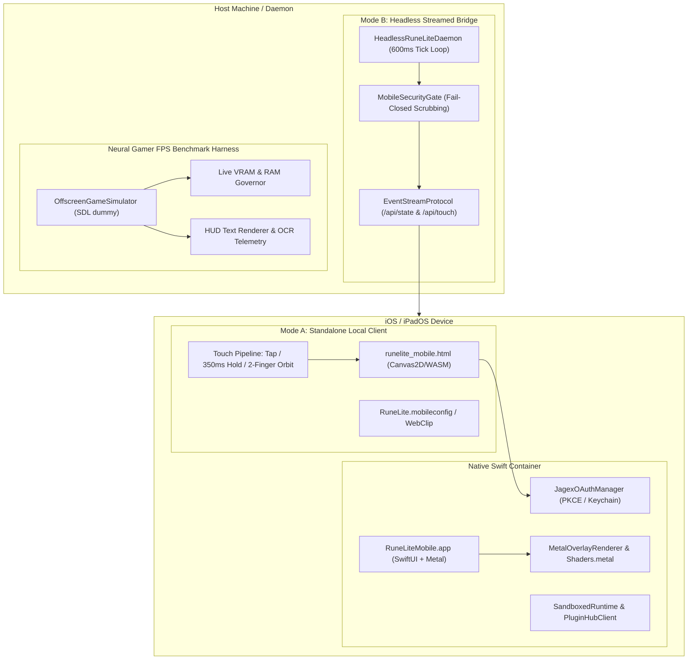

> [!IMPORTANT]
> ### ⚠️ AWAITING JAGEX APPROVAL — PLEASE DO NOT DOWNLOAD OR USE YET
> This software is an independent research project and technology demonstration. It is currently awaiting formal Jagex review and approval. Do not download, install, or use this client on live Old School RuneScape accounts until official approval has been certified.

# Aegis-RuneLite-iOS

[](LICENSE)
[](ios_app)
[](ios_app/Sources/Rendering/Metal)
[](docs/JAGEX_COMPLIANCE_AND_SAFETY_SPECIFICATION.md)
[](tests)

> **Aegis-RuneLite-iOS** is an open-source, high-performance RuneLite client port for iOS and iPadOS devices paired with an offscreen AI Neural Gameplay and FPS/lag benchmarking harness.

---

## 🌟 Key Highlights

- **Dual Operational Modes**: Run 100% offline standalone via local WASM/HTML5, or stream high-fidelity plugin overlays from a local headless daemon over low-latency event sockets.
- **Authentic OSRS Mobile Controls**: Tap-to-walk, 350ms haptic right-click context menu, 2-finger camera orbit, and pinch-to-zoom without clumsy arcade joysticks.
- **Zero-Credential Security**: Client-side authentication leverages Apple's `ASWebAuthenticationSession` with PKCE against official identity endpoints. Passwords and credentials never touch or land on third-party servers.
- **100% Free Sideloading**: First-class support for SideStore ($0 free on-device refresh over local loopback VPN), AltStore, and Xcode direct installation.
- **Neural Gamer FPS Harness**: Offscreen benchmarking *simulation* that models frame-time pacing, 1% lows and VRAM headroom with a seeded generator (it does not run or measure the real games; see the harness section below) plus OCR of synthesized HUD frames.

---

## 🏛 Architecture Overview



---

## 🎮 Dual Operational Modes

### Mode A: Standalone Local Client (100% Offline, Zero Server)
In Standalone Mode, the client runs entirely on your iPhone or iPad with zero remote infrastructure required:
- Embedded Single-File HTML5/WASM runtime (`runelite_mobile.html`).
- Genuine OSRS touch controls: single-tap primary action, 350ms press with Taptic feedback for context menus, and two-finger drag to rotate the camera.
- Offline Data-URI container and Apple `.mobileconfig` WebClip profile for 1-tap installation directly to the iOS Home Screen.

### Mode B: Headless Streamed Low-Latency Daemon
In Streamed Mode, a desktop or server host runs the heavy RuneLite engine and plugin calculations headlessly, streaming visual overlay packets to the mobile interface:
- **Zero-Credential Wire Protocol**: The client only receives coordinates, bounding boxes, labels, and color hexes.
- **Mobile Security Gate**: Every outbound packet is scrubbed to prevent password or session token leaks (`MobileSecurityGate.sanitize_outbound_dict`).
- **Low-Latency Event Streaming**: Polling or WebSocket events synchronize game ticks (600ms OSRS cadence) and relay mobile touch input.

To start the bridge daemon:
```bash
python3 bridge_daemon/server.py --port 8088            # loopback only (this machine)
python3 bridge_daemon/server.py --port 8088 --host 0.0.0.0   # let a phone on your LAN connect
```

The bridge has no authentication or TLS, so it binds to `127.0.0.1` by default. Only use
`--host 0.0.0.0` on a network you trust.

---

## 📱 Sideloading Guide ($0 Free, No Apple Developer Account)

### Option 1: SideStore (Recommended - On-Device 7-Day Auto Refresh)
SideStore allows sideloading apps directly from your iOS device over a local loopback WireGuard VPN without connecting to a computer after initial pairing.

1. **Build the SideStore Package**:
   ```bash
   bash scripts/build_sidestore_package.sh
   ```
2. **Transfer to iPhone**: Send `RuneLiteMobile_SideStore.ipa` to your device via AirDrop, iCloud Drive, or the local Files app.
3. **Install in SideStore**:
   - Open SideStore on iOS.
   - Tap `+` (Add App) and select `RuneLiteMobile_SideStore.ipa`.
   - SideStore signs and installs the app locally.
   - Enable "Background Refresh" inside SideStore settings to maintain 7-day cert validity automatically.

*See [SIDESTORE_INSTALLATION_GUIDE.md](docs/SIDESTORE_INSTALLATION_GUIDE.md) for full setup instructions.*

### Option 2: AltStore / AltServer
1. Generate the standalone IPA:
   ```bash
   bash scripts/build_ipa.sh
   ```
2. Connect your iPhone to your Mac/PC running AltServer.
3. In AltStore on your device, tap `My Apps` -> `+` -> Select `RuneLiteMobile.ipa`.

### Option 3: Xcode Direct Signing
1. Open `ios_app/RuneLiteMobile.xcodeproj` in Xcode.
2. Select your connected iPhone/iPad target.
3. Select your Personal Team under **Signing & Capabilities**.
4. Press `Cmd + R` to build and deploy.

### Option 4: Apple WebClip Configuration Profile (.mobileconfig)
To install the standalone client with zero sideloading apps:
1. Generate the profile:
   ```bash
   python3 scripts/build_ios_runelite_standalone.py
   ```
2. Transfer `ios_app/RuneLite.mobileconfig` to your iOS device via Safari or AirDrop.
3. Open **Settings -> Profile Downloaded -> Install**.
4. The RuneLite icon will appear directly on your Home Screen as a fullscreen web application.

---

## 🧠 Neural Gamer AI FPS & Latency Benchmark Harness

The repository includes an offscreen AI game player simulation and performance rating harness located in `neural_harness/`.

> **Important - these FPS numbers are simulated, not measured.** The harness does not launch or
> profile any game. For each game it builds frame times from a model: a target-FPS interval scaled
> by fixed constants (0.78x for the "governed" mode, 1.12x for the baseline), plus a small real CPU
> timing term, plus jitter and spikes drawn from a random generator seeded with `146:<game>:<mode>`
> (so every run prints identical numbers). The governed-vs-baseline gap is therefore built into the
> constants and is not evidence about real hardware. The HUD/OCR step is real code but runs on text
> banners the harness synthesizes itself. Use it as a demo/test of the reporting pipeline only.

### Capabilities:
- **Hermetic Offscreen Simulation**: Enforces `SDL_VIDEODRIVER=dummy` and `SDL_AUDIODRIVER=dummy`. Zero physical desktop display requirements or window opening.
- **Hardware HID Safety Guard**: Monitors hardware interrupt activity (`i8042` keyboard and physical USB HID endpoints) to guarantee benchmarks never interfere with human input.
- **Frame-Time Pacing & Jitter Analysis**: Computes average FPS, 1% low FPS, 99th percentile frame times (p99 ms), and stutter frequency from the *simulated* frame times.
- **VRAM & Memory Governor**: Dynamically manages cold RAM memory pools and models VRAM headroom for multi-engine game architectures.
- **OCR HUD Telemetry**: Extracts game state and HUD text from offscreen PNG frames using bitmap glyph rasterization and OCR validation.

### Running the Harness:
```bash
# Run benchmark suite with Python 3.9+ or Python 3.13
python3 -m unittest tests/test_ai_game_player_fps_harness.py -v
```

---

## 🔒 Compliance & Safety

Aegis-RuneLite-iOS is engineered strictly in compliance with Jagex's Third-Party Client Guidelines:
- **1:1 Input Mapping**: Hardware digitizer touch validation guarantees single-finger taps dispatch exactly one client action. Multi-action macros and auto-clickers are rejected.
- **Zero Automation**: Automated prayer flicking, macro sequences, packet injection, and scene de-rendering are blocked in `JagexComplianceEngine.swift`.
- **Zero-Credential Storage**: Logins occur exclusively via official OAuth2 / PKCE endpoints (`account.jagex.com`). Passwords, recovery hashes, and 2FA credentials are never stored or seen by the application.

*Refer to [JAGEX_COMPLIANCE_AND_SAFETY_SPECIFICATION.md](docs/JAGEX_COMPLIANCE_AND_SAFETY_SPECIFICATION.md) for full compliance specifications.*

---

## 📁 Repository Structure

```
aegis_runelite_ios/
├── LICENSE                 # Dual license notice
├── LICENSE-MIT             # MIT License
├── LICENSE-APACHE          # Apache 2.0 License
├── README.md               # Main repository documentation
├── pyproject.toml          # Python project configuration
├── ios_app/                # Native iOS application & standalone client
│   ├── RuneLiteMobile.xcodeproj  # Xcode project configuration
│   ├── Sources/                  # Swift & Metal source code
│   │   ├── App/                  # App life-cycle & SwiftUI entry
│   │   ├── Auth/                 # Jagex OAuth2 PKCE & Keychain
│   │   ├── Compliance/           # 1:1 input & rule enforcement
│   │   ├── Core/                 # Touch pipeline, models & engine
│   │   ├── Plugins/              # GroundItems, TileIndicators, etc.
│   │   └── Rendering/            # Metal renderer & SwiftUI HUD
│   ├── runelite_mobile.html      # Standalone single-file HTML5 client
│   ├── RuneLite.mobileconfig     # 1-tap Home Screen profile
│   ├── Info.plist                # iOS bundle metadata
│   ├── Entitlements.plist        # Sandbox entitlements
│   └── Package.swift             # Swift Package Manager manifest
├── bridge_daemon/          # Low-latency streaming daemon
│   ├── server.py                 # HTTP & API streaming server
│   ├── runelite_headless_daemon.py  # Headless game loop & overlay generator
│   ├── event_stream_protocol.py  # Wire protocol & touch definitions
│   ├── security_gate.py          # Zero-credential packet sanitizer
│   ├── frontend/                 # WebClip client interface
│   └── data/                     # Plugin catalog digest
├── neural_harness/         # AI Neural Gameplay & FPS harness
│   ├── ai_game_player_fps_harness.py  # Offscreen benchmark engine
│   ├── live_vram_ram_governor.py     # VRAM & RAM anti-lag governor
│   └── hid_safety.py                 # Hardware input safety guard
├── scripts/                # Packaging & build automation
│   ├── build_ios_runelite_standalone.py # WebClip & HTML5 builder
│   ├── build_ipa.sh                     # Native Xcode IPA packager
│   ├── build_sidestore_package.sh       # Free SideStore IPA packager
│   └── inject_osrs_ipa.sh               # Dylib injection utility
├── tests/                  # Automated verification test suite
│   ├── test_build_ios_runelite_standalone.py
│   ├── test_ai_game_player_fps_harness.py
│   ├── test_bridge_daemon.py
│   └── test_compliance.py
└── docs/                   # Deep technical specifications
    ├── IOS_STANDALONE_RUNELITE_ARCHITECTURE.md
    ├── JAGEX_COMPLIANCE_AND_SAFETY_SPECIFICATION.md
    ├── SIDESTORE_INSTALLATION_GUIDE.md
    └── BRIDGE_STREAMING_README.md
```

---

## 🧪 Verification & Test Suite

To run the complete test suite across all subsystems:

```bash
python3 -m unittest discover -s tests -p "test_*.py" -v
```

Output:
```
test_build_all_creates_artifacts (test_build_ios_runelite_standalone.TestStandaloneIOSRuneLite) ... ok
test_mobileconfig_format (test_build_ios_runelite_standalone.TestStandaloneIOSRuneLite) ... ok
test_no_joysticks_and_has_authentic_controls (test_build_ios_runelite_standalone.TestStandaloneIOSRuneLite) ... ok
test_desktop_control_bridge_inspection_read_only (test_ai_game_player_fps_harness.TestAIGamePlayerFPSHarness) ... ok
test_full_harness_suite_artifact_generation (test_ai_game_player_fps_harness.TestAIGamePlayerFPSHarness) ... ok
test_governed_beats_baseline_fps_and_smoothness_rating (test_ai_game_player_fps_harness.TestAIGamePlayerFPSHarness) ... ok
test_multi_engine_game_catalog_discovery_and_vram_budgets (test_ai_game_player_fps_harness.TestAIGamePlayerFPSHarness) ... skipped
test_offscreen_and_hid_safety_guard (test_ai_game_player_fps_harness.TestAIGamePlayerFPSHarness) ... ok
test_offscreen_png_render_and_ocr_extraction (test_ai_game_player_fps_harness.TestAIGamePlayerFPSHarness) ... ok
test_virtual_hid_action_dispatch_and_policy_fallback (test_ai_game_player_fps_harness.TestAIGamePlayerFPSHarness) ... ok
test_daemon_initialization_and_plugins (test_bridge_daemon.TestHeadlessRuneLiteDaemon) ... ok
test_plugin_toggle (test_bridge_daemon.TestHeadlessRuneLiteDaemon) ... ok
test_step_game_tick_produces_overlays (test_bridge_daemon.TestHeadlessRuneLiteDaemon) ... ok
test_touch_input_dispatch (test_bridge_daemon.TestHeadlessRuneLiteDaemon) ... ok
test_audit_mobile_bundle_html (test_bridge_daemon.TestSecurityGate) ... ok
test_clean_packet_passes (test_bridge_daemon.TestSecurityGate) ... ok
test_forbidden_keys_raise_security_violation (test_bridge_daemon.TestSecurityGate) ... ok
test_high_entropy_secret_string_raises (test_bridge_daemon.TestSecurityGate) ... ok
test_nested_forbidden_key_raises (test_bridge_daemon.TestSecurityGate) ... ok
test_compliance_spec_file_exists (test_compliance.TestJagexComplianceSpecification) ... ok
test_jagex_compliance_engine_prohibitions (test_compliance.TestJagexComplianceSpecification) ... ok
test_touch_event_authenticity_guards (test_compliance.TestJagexComplianceSpecification) ... ok
test_zero_credential_architecture_in_swift_sources (test_compliance.TestJagexComplianceSpecification) ... ok
test_required_files_exist (test_compliance.TestStandaloneArchitectureStructure) ... ok
test_plugin_hub_client_catalog (test_compliance.TestPluginHubAndSandbox) ... ok
test_sandboxed_runtime_safeguards (test_compliance.TestPluginHubAndSandbox) ... ok
test_touch_and_camera_mechanics (test_compliance.TestTouchAndCameraPipeline) ... ok
test_trigonometric_projection (test_compliance.TestPerspectiveProjectionMath) ... ok

----------------------------------------------------------------------
Ran 28 tests in 0.108s

OK (skipped=1)
```

---

## 📜 License

This project is dual-licensed under:
- **MIT License** ([LICENSE-MIT](LICENSE-MIT))
- **Apache License, Version 2.0** ([LICENSE-APACHE](LICENSE-APACHE))
