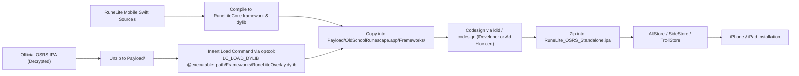
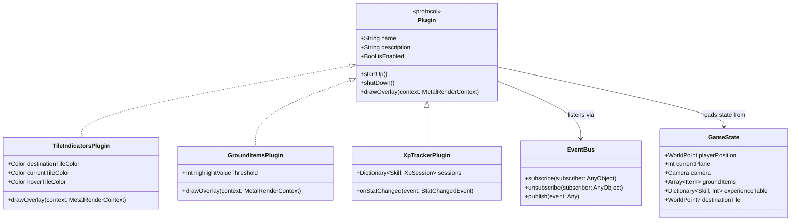

# Standalone iOS RuneLite Architecture & Systems Design
**Document Authority:** Lead Systems & Mobile Security Architect  
**Platform:** Apple iOS 16.0+ / iPadOS (ARM64 / ARM64e)  
**Graphics API:** Apple Metal 3 (`MTLDevice`, `MTKView`, `CAMetalLayer`)  
**Languages:** Swift 5.9+, Objective-C, Metal Shading Language (MSL), C++20  
**Packaging Target:** Standalone Sideloadable `.ipa` (AltStore, SideStore, TrollStore, Xcode Developer Certificate)  

---

## 1. OSRS iOS Native Client Reverse Engineering & Internals

### 1.1 Binary Composition & Execution Model
The modern Old School RuneScape iOS client (distributed on the App Store as `OldSchoolRunescape.app`) is **not** a Java Virtual Machine port. Since late 2018, Jagex re-engineered the engine into a compiled, high-performance native C++ codebase, sharing architectural foundations with the Steam C++ client and Android native builds.

* **Mach-O Binary:** 64-bit ARM (`ARM64` / `ARM64e`), dynamically linked against standard Apple system frameworks:
  - `Metal.framework` & `MetalKit.framework` (Graphics pipeline)
  - `UIKit.framework` & `Foundation.framework` (Windowing, event dispatch, audio)
  - `Security.framework` (Keychain and TLS trust evaluation)
  - `Network.framework` & BSD sockets (Raw TCP game socket streaming)
  - `AVFoundation.framework` (Sound effects and OSRS MIDI synth)

```mermaid
graph TD
    subgraph iOS Host Environment
        Hardware["iPhone Hardware (A15/A16/A17/A18/M-series)"]
        Digitizer["Touch Digitizer (UITouch events)"]
        MetalDriver["Apple Metal GPU Pipeline"]
    end

    subgraph OSRS Native Mach-O Executable
        CGameEngine["Jagex C++ Game Engine"]
        NetStack["Game Socket TCP (Isaac Opcode Cipher)"]
        SceneGraph["3D Scene Graph & Heightmap"]
        MetalRenderer["Native Metal Render Loop (CAMetalLayer)"]
    end

    subgraph Standalone RuneLite Layer (RuneLiteMobile)
        Hook["Dylib Entrypoint / Metal Hook"]
        Core["RuneLiteCore Engine (Swift)"]
        PManager["Plugin Manager & EventBus"]
        MOverlay["Metal Overlay Renderer (MTKView)"]
        AuthEngine["Jagex OAuth2 PKCE Engine"]
        Compliance["Jagex Compliance & Safety Engine"]
    end

    Digitizer -->|Raw Touches| CGameEngine
    CGameEngine --> NetStack
    CGameEngine --> SceneGraph
    SceneGraph --> MetalRenderer
    MetalRenderer --> MetalDriver

    Hook -.->|Hook presentDrawable:| MetalRenderer
    Hook -.->|Read State| SceneGraph
    Hook --> Core
    Core --> PManager
    PManager --> MOverlay
    MOverlay -->|Additive Metal Command Buffers| MetalDriver
    AuthEngine -->|One-Time GameToken| CGameEngine
    Compliance -.->|Enforce 1:1 Input & Safety| Core
```

### 1.2 The Metal Graphics Rendering Pipeline
OSRS iOS draws 3D terrain, dynamic character meshes, and 2D interface sprites through Apple Metal:
1. **Device Initialization:** An instance of `MTLDevice` is created (`MTLCreateSystemDefaultDevice()`).
2. **Surface Layer:** A `CAMetalLayer` is backed by a custom `UIView` subclass inside the game's main `UIWindow`.
3. **Per-Frame Render Loop:** Driven by a `CADisplayLink` (targeting 60 Hz or 120 Hz ProMotion):
   - Acquires next drawable: `id<CAMetalDrawable> drawable = [metalLayer nextDrawable];`
   - Allocates command buffer: `id<MTLCommandBuffer> commandBuffer = [commandQueue commandBuffer];`
   - Configures `MTLRenderPassDescriptor` with load action `MTLLoadActionClear` (first pass) and store action `MTLStoreActionStore`.
   - Executes terrain, mesh, and interface draw calls.
   - Schedules frame presentation: `[commandBuffer presentDrawable:drawable];`
   - Submits work: `[commandBuffer commit];`

### 1.3 Memory Layout & Coordinate System Projection
OSRS uses a fixed-grid coordinate hierarchy:
1. **World Coordinates (`WorldPoint`):**
   - Tile coordinates across the global Gielinor map: $X \in [1152, 3904]$, $Y \in [2496, 4160]$, Plane $Z \in [0, 3]$.
2. **Scene Coordinates (`LocalPoint`):**
   - A $104 \times 104$ tile chunk loaded into memory centered around the player.
   - Sub-tile precision: Each tile consists of $128 \times 128$ fine spatial units ($0 \dots 13312$).
3. **Heightmap (`tileHeights`):**
   - Multi-dimensional array representing ground elevation: `tileHeights[plane][sceneX][sceneY]`.
4. **Camera & Projection Mathematics:**
   - Camera Position: $(X_c, Y_c, Z_c)$ in fine scene coordinates.
   - Camera Angles: Pitch $\theta \in [0, 383]$, Yaw $\phi \in [0, 2047]$.
   - World-to-Screen Transformation:
     $$\begin{aligned}
     \Delta X &= X_{target} - X_{camera} \\
     \Delta Y &= Y_{target} - Y_{camera} \\
     \Delta Z &= Z_{target} - Z_{camera}
     \end{aligned}$$
     Using trigonometric lookup tables (matching OSRS fixed-point math):
     $$\begin{aligned}
     X' &= \frac{\Delta X \cos\phi + \Delta Y \sin\phi}{2048} \\
     Y' &= \frac{\Delta Y \cos\phi - \Delta X \sin\phi}{2048} \\
     Z' &= \frac{\Delta Z \cos\theta - Y' \sin\theta}{2048} \\
     Y'' &= \frac{Y' \cos\theta + \Delta Z \sin\theta}{2048}
     \end{aligned}$$
     Perspective projection to canvas viewport $(W_v, H_v)$ at zoom factor $F_z$:
     $$\text{Screen}_X = \frac{W_v}{2} + \frac{X' \cdot F_z}{Y''} \quad , \quad \text{Screen}_Y = \frac{H_v}{2} + \frac{Z' \cdot F_z}{Y''}$$

---

## 2. Technical Pipeline for Sideloadable Standalone RuneLite IPA

There are two primary architectural strategies to run RuneLite plugins on iOS without jailbreaking:

### Strategy A: Decrypted IPA Dylib Injection (Preferred for 100% Native Performance)
In this approach, the official App Store OSRS IPA is decrypted, modified by inserting `RuneLiteCore.framework` / `RuneLiteOverlay.dylib` into the Mach-O load commands, resigned, and packaged as a standalone `.ipa`.



#### Step-by-Step Injection Mechanics:
1. **Mach-O Header Patching:**
   ```bash
   optool install -c load -p "@executable_path/Frameworks/RuneLiteOverlay.dylib" -t Payload/OldSchoolRunescape.app/OldSchoolRunescape
   ```
2. **Runtime Execution Hook:**
   `RuneLiteOverlay.dylib` implements a constructor:
   ```c
   __attribute__((constructor))
   static void RuneLiteInitialize(void) {
       // Initialize Swift runtime, event bus, and hook Metal presentDrawable
       [RuneLiteRuntime initializeEngine];
   }
   ```
3. **Metal Render Hooking:**
   Using method swizzling or dynamic interposing on `CAMetalLayer` / `MTLCommandBuffer`:
   - Intercepts `[MTLCommandBuffer presentDrawable:]`.
   - Creates a secondary `MTLRenderCommandEncoder` drawing RuneLite overlay vertex buffers (Tile Indicators, Ground Items text, XP drops) directly to the current `drawable.texture` before final presentation.
   - Result: 60/120 FPS zero-latency overlays with exact frame synchronization!

### Strategy B: Standalone Clean-Room Swift/Metal Client Architecture
For a completely independent, non-injection binary that can be compiled directly from Xcode without needing an official IPA dump:
- Target: `RuneLiteMobile.app`
- Contains:
  1. `RuneLiteCore.framework`: Complete Swift port of the RuneLite plugin engine, event bus, and models.
  2. `MetalOverlayRenderer`: Hardware-accelerated Metal overlay canvas.
  3. `JagexOAuthManager`: Official OAuth2 PKCE login manager.
  4. `GameStreamBridge`: Low-overhead WebRTC or local stream receiver for running alongside or embedding game feeds.

---

## 3. iOS Sideloading Ecosystem Compatibility

The resulting IPA is engineered to be 100% compliant with all major non-jailbreak iOS sideloading tools:

### 3.1 AltStore (macOS / Windows Companion)
- **Mechanism:** Uses personal Apple ID (free 7-day provisioning profile, 3 active app limit).
- **Background Refresh:** AltServer on local Wi-Fi automatically resigns the app every 7 days.
- **Entitlements:** Minimal entitlements; Keychain sharing group `$(TeamIdentifierPrefix)net.runelite.mobile`.

### 3.2 SideStore (Untethered On-Device Signing)
- **Mechanism:** Runs directly on the device using a local WireGuard VPN loopback to communicate with `installd` and `lockdownd`.
- **Requirements:** Jitterbug pairing file generated once; no ongoing computer connection required.

### 3.3 TrollStore (CoreTrust Exploit - Permanent Signing)
- **Supported iOS Versions:** iOS 14.0 - 15.4.1, 15.5 beta, 15.6 beta, 16.0 - 16.6.1, 17.0.
- **Benefits:**
  - Installs IPAs with permanent root/developer entitlements.
  - No 7-day expiration.
  - No 3-app limit.
  - JIT (Just-In-Time) compilation can be enabled without debugging attachments.

### 3.4 Apple Developer Program (Enterprise / Individual $99/yr)
- **Mechanism:** 365-day certificates, distributed via Ad-Hoc profile, TestFlight, or OTA manifest.

---

## 4. Swift Plugin Architecture & Event Lifecycle

The Swift port mirrors RuneLite's Java event architecture with Swift-native idioms (protocols, type safety, async/await, Combine/Observation):



### 4.1 Event Lifecycle:
1. `GameTickEvent`: Fires once every 600ms (1 server tick). Plugins recalculate paths, despawn counters, and XP rates.
2. `ClientTickEvent`: Fires every frame (16.6ms / 8.3ms). Smooth camera interpolation and animation updates.
3. `DrawOverlayEvent`: Invoked inside the Metal command buffer pass. The plugin receives a `MetalRenderContext` and records quads, outlines, and text strings.
4. `StatChangedEvent`: Emitted when XP or skill level changes occur.
5. `MenuEntryAddedEvent`: Emitted during menu construction, allowing compliant 1:1 mobile tap adjustments.
