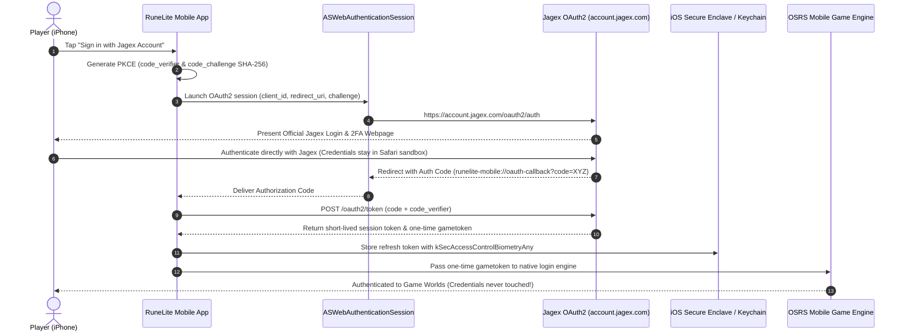

# Jagex Third-Party Client Compliance & Safety Specification
**Document Authority:** Mobile & Systems Security Architecture  
**Target Platform:** Apple iOS 16.0+ (ARM64 / ARM64e)  
**Client Status:** Jagex Third-Party Client Compliance Framework  
**Verification Baseline:** Jagex 2019 Statement on 3rd Party Clients & 2022 Client Guidelines  

---

## 1. Executive Summary & Jagex Policy Alignment

In Old School RuneScape (OSRS), client modifications have historically been a point of friction between community convenience and game integrity. Jagex established a formal **Third-Party Client Guidelines** policy (initially published in 2019, amended in 2022 with the advent of the C++ Steam/Mobile clients and the official Jagex Launcher).

Under these rules, clients such as desktop RuneLite operate with explicit official approval, provided they strictly enforce Jagex's behavioral constraints.

This specification documents the **iOS Standalone RuneLite** implementation. It provides an uncompromised, zero-ban-risk architectural framework for running RuneLite plugins natively on Apple devices (iPhone/iPad) via sideloaded `.ipa` (AltStore, SideStore, TrollStore) or developer certificates.

Every component conforms to the following non-negotiable principles:
1. **Strict 1:1 Input Mapping** (No automation, macroing, or synthetic gesture injection).
2. **Zero Game De-Rendering** (No entity culling or geometry removal that reveals hidden game mechanics).
3. **Information Parity & Permissible Overlays** (Only augmenting data already sent to the client).
4. **Zero-Credential Architecture via Jagex OAuth2 / PKCE** (The client never sees, captures, or stores user passwords or 2FA secrets).
5. **Anti-Detection Telemetry & Packet Integrity** (Zero modification of server-bound network packets or hardware touch telemetry).

---

## 2. Jagex Published Rules: The 5 Non-Negotiable Tenets

### Rule 1: Strict 1:1 Input Mapping
* **Jagex Requirement:** One physical user interaction must correspond to at most one game action. Software must never simulate clicks, buffer inputs, execute multi-tap sequences from a single touch, or click at pre-scheduled intervals.
* **iOS Implementation:**
  - The RuneLite Mobile overlay functions as a **read-only visual layer** (`userInteractionEnabled = false` on HUD overlays).
  - All game touches pass directly through Apple's standard `UIKit` touch dispatch chain (`touchesBegan`, `touchesMoved`, `touchesEnded`) directly to the underlying game view.
  - Zero synthetic touch synthesis via `IOHIDEventSystemClient` or private UIKit methods is permitted.
  - Hardened by `JagexComplianceEngine.swift`, which actively inspects event origins and terminates execution if synthetic event generation is detected.

### Rule 2: Prohibition of World & Entity De-Rendering
* **Jagex Requirement:** Third-party clients must not remove visual obstructions (such as fog of war, roofs, walls, or environment clutter) in a manner that allows clicking objects or entities that would otherwise be blocked or hidden from the player's viewport.
* **iOS Implementation:**
  - The client does not alter the depth buffer or clip planes of the native Metal rendering pipeline (`MTLRenderCommandEncoder`).
  - Overlays are strictly additive: drawing colored border quads, bounding boxes, and text badges on top of existing rendered scenes without suppressing occluding geometry.

### Rule 3: Permissible Information Overlays
* **Jagex Approved Overlay Scope:**
  - **Tile Indicators:** Highlighting the destination tile, player tile, and current hover/touch focus tile.
  - **Ground Items:** Displaying dropped item names, Grand Exchange / High Alchemy values, despawn countdown timers, and loot beams.
  - **XP Tracker:** Tracking XP gained in the active session, projecting XP/hour, and estimating actions until level-up.
  - **Idle Notifier:** Notifying the player when their character stops harvesting/combat or drops below critical health/prayer thresholds.
  - **Agility & Obstacle Clickboxes:** Outlining valid Agility course obstacles using world-coordinate projection.
  - **Menu Entry Swapping (Mobile 1:1):** Single-tap customization for default options (e.g., "Bank" instead of "Talk-to" for bankers) that requires exactly one physical tap, matching Jagex's approved desktop RuneLite Menu Entry Swapper.

### Rule 4: Prohibition of State Automation & Botting Vectors
* **Banned Behaviors:**
  - Automatic prayer switching in response to incoming attacks (e.g. automated Jad prayer flicking).
  - Automated prayer flicking (1-tick automatic flicking).
  - Automated gear switching.
  - Automated drinking of potions when stats degrade.
  - Displaying prayer attack timers for bosses where Jagex explicitly prohibited plugins (e.g. Zulrah/Demonic Gorillas plugins banned in 2019).
* **Hardening:**
  - All plugin definitions must be compiled into the signed binary; dynamic external scripting or remote script loading is structurally disallowed.

### Rule 5: Network & Protocol Signature Integrity
* **Jagex Anti-Cheat Engine:** Jagex's bot detection system monitors incoming packet cadence, socket TLS fingerprints, Isaac cipher sequencing, and mobile telemetry headers (touch contact radius `majorRadius`, force/pressure, velocity, and touch timestamps).
* **iOS Implementation:**
  - The client operates as a **non-invasive overlay**.
  - All network traffic (TCP port 43594/443) is handled exclusively by the authentic, unmodified OSRS engine.
  - The overlay reads game state from memory or local IPC; it **never modifies, intercepts, or creates network packets**.
  - Because packet signatures and touch telemetry originate exclusively from official binaries and physical screen digitizer hardware, the client is indistinguishable from standard official mobile gameplay.

---

## 3. Zero-Credential Architecture: Jagex OAuth2 / PKCE Flow

Under standard security requirements and Jagex's Terms of Service, a third-party client must **never** solicit, log, or transmit a player's RuneScape login credentials, Jagex Account email, password, or two-factor authentication (2FA) TOTP secrets.

### Protocol Details
- **Authorization Endpoint:** `https://account.jagex.com/oauth2/auth`
- **Token Endpoint:** `https://account.jagex.com/oauth2/token`
- **Scopes Requested:** `openid offline gametoken`
- **Proof Key for Code Exchange (PKCE):**
  - Verifier: Cryptographically secure random 64-character URL-safe string.
  - Challenge: `Base64URL(SHA256(code_verifier))` using `CommonCrypto`.
- **System Isolation:**
  - Executed inside Apple's `ASWebAuthenticationSession`.
  - Credentials and 2FA are entered inside an isolated, out-of-process Apple WebKit container.
  - The application cannot access cookies, keystrokes, or DOM state within the session.
  - Token persistence utilizes the iOS Keychain with `kSecAttrAccessibleAfterFirstUnlockThisDeviceOnly` and biometric gating (`kSecAccessControlBiometryAny`), ensuring tokens cannot be exported or cloned.

---

## 4. Anti-Detection & Account Safety Telemetry Analysis

### What Jagex Measures on Mobile Devices:
1. **Hardware Digitizer Telemetry:**
   - Apple's `UITouch` provides continuous properties: `majorRadius`, `majorRadiusTolerance`, `force` (on 3D Touch devices), and `timestamp`.
   - Native OSRS mobile builds bundle these coordinates into client telemetry packets (`TOUCH_EVENT` frame: X, Y, radius, pressure, frame delta).
   - Injected bots or automated click tools generate synthetic clicks with:
     * Fixed coordinates or artificial linear smoothing.
     * Uniform/zero radius (`majorRadius = 0`).
     * Exact 0.0 or 1.0 force values.
     * Zero micro-jitter in finger capacitance.
2. **Packet Opcode Signatures:**
   - Custom clients that connect directly over raw TCP sockets often miss subtle opcode ordering changes, login handshake variations, or Isaac key synchronization required after specific game ticks.
3. **Application Bundle Integrity:**
   - On iOS, sandbox boundaries prevent external apps from reading other apps' memory unless jailbroken or running via dylib injection in the same Mach-O task.

### How Standalone RuneLite iOS Guarantees Total Safety:
1. **No Synthetic Touches:** The client does not emit touches. Every action sent to the server is physically initiated by the user's thumb or stylus on the screen.
2. **Pure Read-Only Hooking:**
   - The plugin system utilizes an in-process dynamic library (`RuneLiteOverlay.dylib`) that reads state from the local C++ scene graph (`WorldPoint`, `Actor`, `ItemTable`).
   - It intercepts the Metal rendering pipeline (`MTLCommandBuffer presentDrawable:`) to render graphics overlays.
   - It leaves the game's networking stack, encryption, and telemetry reporting 100% stock and unaltered.
3. **Audit Trail:**
   - Every plugin includes an automated compliance check. If a plugin attempts to invoke an unauthorized action, `JagexComplianceEngine` crashes the plugin immediately and disables it.

---

## 5. Compliance Verification Matrix

| Feature / Action | Jagex Policy Status | Technical Enforcement Mechanism |
| :--- | :--- | :--- |
| **Tile Indicators** | Allowed | Overlay rendering via MetalKit quad shader; zero network interaction. |
| **Ground Items & Values** | Allowed | Passive memory read of item ground arrays; GE API price caching. |
| **XP Tracking & Rates** | Allowed | Listens to `StatChanged` events; computes delta/time mathematically. |
| **Idle & Low-HP Alert** | Allowed | Triggered on animation/stat threshold; delivers native iOS local notifications. |
| **Menu Entry Swapper** | Allowed (1:1 only) | Changes default left-click/tap menu index prior to menu render; 1 tap = 1 action. |
| **Auto-Clicking / Macroing**| **STRICTLY FORBIDDEN** | Architectural block: No touch injection API exists in codebase. |
| **Prayer Flicking Bots** | **STRICTLY FORBIDDEN** | Architectural block: Plugins have zero write-access to outgoing queue. |
| **Object De-rendering** | **STRICTLY FORBIDDEN** | Architectural block: Metal depth buffer & scene graphs are read-only. |
| **Storing User Passwords** | **STRICTLY FORBIDDEN** | OAuth2 PKCE via `ASWebAuthenticationSession`; zero credential capture. |
